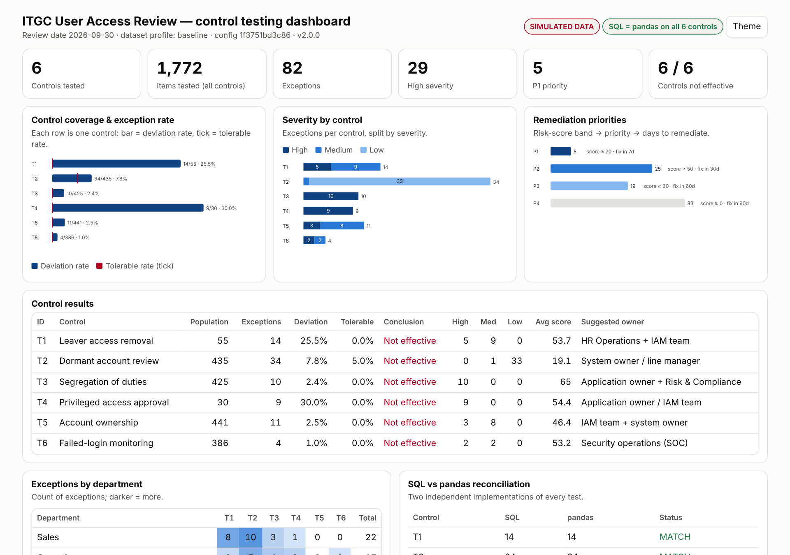
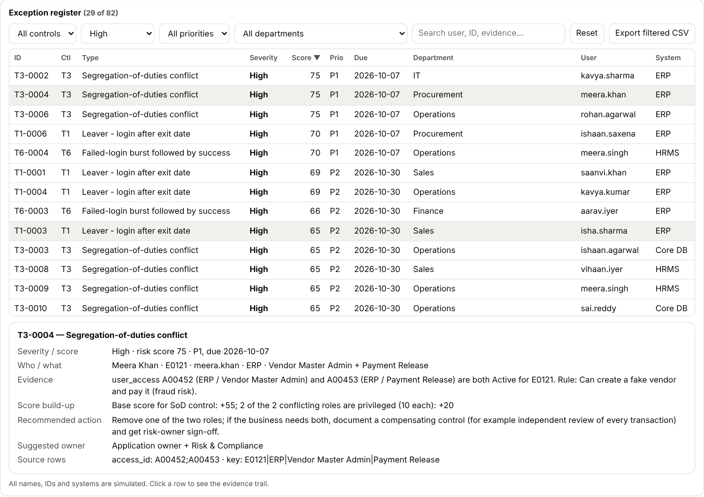

# ITGC User Access Review & Control Testing Analytics

Python tool that runs six IT General Controls (ITGC) access-management tests, **proves its own results with a second,
independent implementation**, scores and prioritises every exception, and produces an Excel audit workpaper, CSVs and an
interactive dashboard.

> ## ⚠️ ALL DATA IS SIMULATED
> Every employee, username, system, login and ticket in this repository is **synthetic**, produced by a seeded generator
> (`itgc-uar generate`). No real organisation, person or system is represented. Results show how the tool behaves on
> planted problems; they say nothing about any real company.



## Why this exists (IT audit / Digital Risk use case)

In a technology-risk or SOX/IFC engagement, "logical access" is one of the first ITGC areas tested. The team receives
system user lists, an HR leavers report and authentication logs (information produced by the entity, "IPE"), and must
answer questions such as *did every leaver lose access? who can both create and pay a vendor? were privileged grants
approved?* Doing this by hand in Excel is slow and hard to re-perform. This project shows an automated, repeatable,
evidence-backed way to do it:

* every test is re-performable from the raw files (hashes are recorded);
* every finding points to the source rows that caused it;
* the logic is written twice (SQL + pandas) and the two are reconciled, a software analogue of re-performance;
* output is shaped like audit working papers: population, exceptions, deviation rate vs tolerable rate, conclusion.

## Quick start

Requires Python 3.10+ (developed on 3.13; also run on pandas 2.2.3 and 3.0.5).

```bash
git clone https://github.com/yashi-7777/itgc-user-access-review-control-testing-analytics.git
cd itgc-user-access-review-control-testing-analytics
python -m venv .venv && source .venv/bin/activate        # Windows: .venv\Scripts\activate
pip install -e ".[dev]"

itgc-uar all                       # generate simulated data + run all tests + write reports
# open outputs/ITGC_UAR_Dashboard.html in a browser, and outputs/ITGC_UAR_Exception_Report.xlsx in Excel
```

Other commands:

```bash
itgc-uar all --profile enterprise        # 2,000 employees, 5 systems, boundary decoys
itgc-uar generate --profile baseline --out data
itgc-uar run --data data --out outputs --config my_config.yaml --review-date 2026-09-30
pytest                                    # full test-suite
pytest --cov=itgc_uar                     # with coverage
ruff check .                              # lint
```

Exit codes: `0` ok · `1` bad input/config · `2` SQL-vs-pandas **mismatch** · `3` data-quality error.

## The six controls

| ID | Test | Idea |
|----|------|------|
| T1 | Leaver access | Terminated employee whose account is still Active (and was it used after exit?) |
| T2 | Dormant accounts | Active account unused for more than 90 days, or never used |
| T3 | Segregation of duties | One person holding both roles of an SoD rule (e.g. Vendor Master Admin + Payment Release) |
| T4 | Privileged approval | Privileged account with no (or blank) approval ticket |
| T5 | Account ownership | Shared/generic accounts and orphan accounts with no HR record |
| T6 | Failed-login bursts | ≥5 failures in 10 minutes, and whether a success followed within 30 minutes |

Detection rules, boundary cases, scoring and priorities are in [docs/CONTROLS.md](docs/CONTROLS.md); design in
[docs/ARCHITECTURE.md](docs/ARCHITECTURE.md). All thresholds are configurable ([config/default.yaml](src/itgc_uar/config/default.yaml)).

## Sample output (baseline profile, seed 42, review date 2026-09-30, **simulated**)

400 employees (48 terminated), 482 access entitlements, 2,840 login events.

| Control | Population | Exceptions | Deviation | High / Med / Low | SQL = pandas |
|---------|-----------:|-----------:|----------:|------------------|:------------:|
| T1 Leaver access | 55 | 14 | 25.5 % | 5 / 9 / 0 | ✔ |
| T2 Dormant accounts | 435 | 34 | 7.8 % | 0 / 1 / 33 | ✔ |
| T3 Segregation of duties | 425 | 10 | 2.4 % | 10 / 0 / 0 | ✔ |
| T4 Privileged approval | 30 | 9 | 30.0 % | 9 / 0 / 0 | ✔ |
| T5 Account ownership | 441 | 11 | 2.5 % | 3 / 8 / 0 | ✔ |
| T6 Failed-login bursts | 386 | 4 | 1.0 % | 2 / 2 / 0 | ✔ |
| **Total** | | **82** | | **29 High** | |

These are the same headline numbers as the first version of the project; a test pins them, and another test checks that the
regenerated CSVs are byte-identical (SHA-256) to the originals.

Each finding carries its evidence, score build-up and recommended action:



### What you get in `outputs/`

| File | Content |
|------|---------|
| `ITGC_UAR_Exception_Report.xlsx` | Cover (labelled SIMULATED), Summary, Exception Register, Remediation Plan, one sheet per control, By Department, Data Quality, Reconciliation, Synthetic Validation, Config |
| `ITGC_UAR_Dashboard.html` | Self-contained, offline dashboard: coverage, severity, priorities, department heat-map, filters, evidence drill-down, CSV export, light/dark |
| `csv/` | Register, summary, per-control exceptions, data quality, synthetic validation |
| `run_manifest.json` | Input SHA-256 hashes, config fingerprint, versions, per-control counts, output hashes |
| `run.log` | Full debug log |

## How correctness is checked (and what that does *not* prove)

1. **SQL vs pandas reconciliation** on every run: exception keys, every attribute, and the population count must agree.
   Tests deliberately break one side (e.g. `>` → `>=`) and assert that the engine reports a mismatch.
2. **Hand-built edge cases**: 90 vs 91 days idle, 4 vs 5 failures, exactly-10-minute windows, success after 29 vs 31 minutes,
   exit-day logins, future-dated exits, whitespace-only tickets, disabled roles, duplicate grants.
3. **Ground-truth validation (simulated data only)**: the generator records what it planted and what it built as a
   boundary "decoy". On both profiles every planted problem is detected and no decoy is flagged
   (baseline 82/82; enterprise 392/392, 0 of 63 decoys flagged).
4. **Regression**: v1 numbers and files are pinned.
5. **Real-browser test** of the dashboard (Playwright/Chromium): load without console errors, filters, drill-down, sort, mobile width, dark mode.

Honest caveat: the generator and the tests were written by the same author, so ground-truth recall of 100 % shows the logic
matches the *intended* rules - not that the rules are the right ones for a real client. The independent SQL/pandas
implementations catch coding mistakes, not misunderstandings of the control objective.

**Test status** (Python 3.13.16, pandas 3.0.5): `pytest` → 73 passed; coverage 98 % of `src/itgc_uar`; `ruff check .` clean.
The non-browser tests (71) also pass on pandas 2.2.3 in a fresh virtualenv with a non-editable install.

## Enterprise profile

`itgc-uar all --profile enterprise` → 2,000 employees, 3,137 entitlements, 18,656 events, 6 SoD rules across ERP, HRMS,
Core DB, Treasury and Cloud IAM; 392 exceptions (140 High), all reconciled, finishing in about a second.

## Repository layout

```
src/itgc_uar/      package (config, dataset, dataquality, datagen, controls, reconcile, scoring, engine, validate, cli, reporting/)
src/itgc_uar/sql/  the six SQL tests (heavily commented)
tests/             73 tests
docs/              CONTROLS.md, ARCHITECTURE.md, screenshots
```

## Limitations

* Simulated data with clean, planted patterns; real exports are messier (multiple accounts per person, inconsistent
  usernames, time zones, service accounts, role hierarchies). The data-quality checks help but do not solve this.
* Controls are rule-based tests over full populations; no sampling, no judgement of compensating controls, no check
  that the HR master itself is complete and accurate beyond basic consistency.
* The risk score and its weights are a transparent heuristic, **not** an industry standard; tolerable rates are illustrative.
* Orphan detection relies on `employee_id` joins; matching by name/e-mail is not implemented.
* Login logs cover 90 days; T6 uses fixed windows per account/system (no IP, geo or device signals).
* Dashboard numbers are embedded at generation time (static file, no live data source).
* Tested on Linux, Python 3.13; Windows/macOS not tested.

## Licence

MIT. See [LICENSE](LICENSE).
